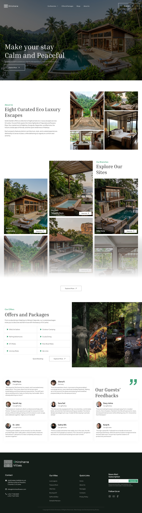

# Shirohana Villas — Landing Page

A modern, responsive landing page for **Shirohana Villas**, a collection of eco-luxury villa stays across Sri Lanka. Built with Vite, vanilla HTML/JS, and SCSS.

> 🌐 **Live Demo:** [https://your-site-name.netlify.app](https://your-site-name.netlify.app) <!-- Replace with your actual Netlify URL -->

## Preview



---

## Prerequisites

Make sure the following are installed on your machine before getting started:

- [Node.js](https://nodejs.org/) v18 or later
- npm (comes bundled with Node.js)

---

## Getting Started

### 1. Clone the repository

```bash
git clone https://github.com/rvndu-perera/Landing-Page-Sample.git
cd "Landing-Page-Sample"
```

### 2. Install dependencies

```bash
cd frontend
npm install
```

### 3. Start the development server

```bash
npm run dev
```

The site will be available at **http://localhost:5173**

---

## Available Scripts

All scripts are run from inside the `frontend/` directory.

| Command | Description |
|---|---|
| `npm run dev` | Starts the local dev server with hot reload |
| `npm run build` | Builds the production bundle to `frontend/dist/` |
| `npm run preview` | Previews the production build locally |

---

## Deployment (Netlify)

This project includes a root `netlify.toml` file pre-configured for one-click deployment:

- **Base directory:** `frontend`
- **Build command:** `npm run build`
- **Publish directory:** `dist` (resolves to `frontend/dist`)
- **SPA Redirects:** Handled automatically via `netlify.toml` and `frontend/public/_redirects`

### Steps to Deploy:
1. Push your repository to GitHub / GitLab / Bitbucket.
2. Sign in to [Netlify](https://app.netlify.com/) and click **Add new site** > **Import an existing project**.
3. Choose your repository. Netlify will auto-detect the configuration settings from `netlify.toml`.
4. Click **Deploy site**.
5. Once your deployment succeeds, copy your generated URL (e.g., `https://<site-name>.netlify.app`) and update the [Live Demo](#shirohana-villas--landing-page) link above!

---

## Project Structure

```
Landing-Page-Sample/
├── netlify.toml                # Netlify deployment configuration
├── images/
│   └── desktop-version.jpg     # Landing page preview
└── frontend/
    ├── public/
    │   ├── _redirects          # Netlify SPA redirect rules
    │   └── favicon.png          # Site favicon
    ├── src/
    │   ├── assets/              # Images and logos
    │   ├── scss/
    │   │   ├── components/      # Navbar, dropdown component styles
    │   │   ├── sections/        # Per-section styles (hero, about, sites, offers, etc.)
    │   │   ├── _base.scss       # Global resets and base styles
    │   │   ├── _variables.scss  # Design tokens (colors, fonts, spacing)
    │   │   └── main.scss        # Root stylesheet — imports all partials
    │   └── main.js              # App entry point — markup, logic, and controllers
    ├── index.html               # HTML shell
    └── package.json
```

---

## Tech Stack

| Tool | Purpose |
|---|---|
| [Vite](https://vitejs.dev/) | Build tool and dev server |
| [Sass / SCSS](https://sass-lang.com/) | Styling |
| [Bootstrap 5](https://getbootstrap.com/) | Responsive grid and utility classes |
| [Bootstrap Icons](https://icons.getbootstrap.com/) | Icon set |
| [Plus Jakarta Sans](https://fonts.google.com/specimen/Plus+Jakarta+Sans) | Body typeface |
| [Inria Serif](https://fonts.google.com/specimen/Inria+Serif) | Display / heading typeface |

Bootstrap's containers, rows, columns, and utilities provide the responsive layout for the main content sections. Custom SCSS preserves the page's visual styling and handles bespoke layouts such as the villa-site masonry grid, hero slideshow, and navigation drawer.
